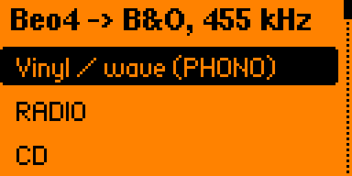

# Beo4 for Flipper Zero

A Flipper Zero app that works as a Bang & Olufsen **Beo4** remote.



B&O gear listens on a **455 kHz** IR carrier. The stock Infrared app on Flipper only
transmits 10–56 kHz, so it cannot talk to B&O at all. This app drives the IR LED itself:
the IR pin (PB9) is the TIM1_CH3N output, the timer runs a 457 kHz PWM (64 MHz / 140),
and each 200 µs flash is opened and closed by switching the channel's output mode.
No extra hardware is needed.

## Tested

On a BeoSound Ouverture system with BeoLab 2000 speakers in Master Link link rooms,
Flipper firmware Momentum `mntm-009`:

| Key | Address / command | Result |
|---|---|---|
| Vinyl / wave (PHONO) | `0x01 / 0x93` | ✅ switches the Ouverture to its AUX input |
| RADIO | `0x01 / 0x81` | ✅ |
| CD | `0x01 / 0x92` | ✅ |
| Volume + / − | `0x01 / 0x60`, `0x01 / 0x64` | ✅ |

PHONO also works when aimed at a BeoLab 2000 in a link room:
it starts the main room's source there.

On the Ouverture the AUX input answers to PHONO, not to A.AUX (`0x01 / 0x83`) or V.AUX (`0x01 / 0x82`).

Not tested yet: A.TAPE, GO, STOP, Standby, ALL off (`0x0F / 0x0C`).
Reports welcome.

## Build and install

With [ufbt](https://github.com/flipperdevices/flipperzero-ufbt) and the SDK of your firmware:

```bash
ufbt          # builds dist/beo4_remote.fap
ufbt launch   # installs to the Flipper over USB and starts it
```

Or copy `beo4_remote.fap` from [Releases](../../releases) to `SD/apps/Infrared/`.
The release build is for Momentum `mntm-009` (API 79.2); for other firmware build it yourself.

The app takes TIM1 directly. If the timer is busy (another IR app is running), it blinks red and exits.

## Protocol

A Beo4 frame is a series of 200 µs flashes; the value is the gap to the next flash:
3125 µs = `0`, 6250 µs = same as previous bit, 9375 µs = `1`, 12500 µs = stop, 15625 µs = start.
Order: `0`, `0`, start, link bit, 8-bit address, 8-bit command (MSB first), stop, final flash.

Sources:
- [aanban/esp32_beo4](https://github.com/aanban/esp32_beo4)
- [ESPHome beo4_protocol](https://api-docs.esphome.io/beo4__protocol_8cpp_source)
- [christianlykke9/Beomote](https://github.com/christianlykke9/Beomote), `Commands.h` for the key codes

## По-русски

Пульт Beo4 для техники Bang & Olufsen на Флиппере. У B&O несущая 455 кГц, а штатное
приложение «Инфракрасный порт» умеет только 10–56 кГц, поэтому светодиодом управляем
напрямую через таймер TIM1. Проверено на BeoSound Ouverture: PHONO (вход AUX), RADIO и CD
переключают источник, громкость ± работает; PHONO, направленный на BeoLab 2000 в комнате-ссылке, включает там
звук главной комнаты по Master Link. Остальные кнопки пока не проверены.

## License

MIT
